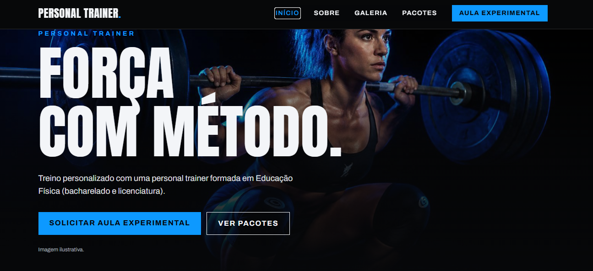

# Personal Trainer 💪

## Sobre o projeto

Aplicativo web voltado para a apresentação de serviços de Personal Trainer, desenvolvido com o auxílio do Lovable.

O projeto apresenta uma interface moderna e responsiva, com identidade visual em azul e preto, oferecendo informações sobre treinamento personalizado.

## Tecnologias

- TypeScript
- Lovable
- Git e GitHub para versionamento

## Acessar o projeto

🌐 **Site publicado:** https://bruna-blue-motion.lovable.app

## Objetivo

Aplicar conhecimentos de desenvolvimento web e ampliar meu portfólio de projetos durante minha formação em Análise e Desenvolvimento de Sistemas.

## Desenvolvimento

Projeto em evolução, com futuras melhorias planejadas para a experiência dos usuários.
